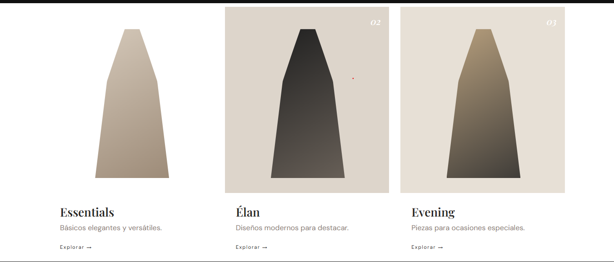
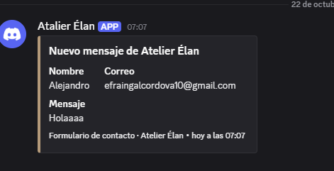

# Portafolio de Proyecto Web: Sistema de Ventas para Tiendas de Conveniencia

**Estudiante:** [Alejandro Efrain Galdamez Cordova]  
**Fecha:** 22 de octubre de 2026  
**Enlace al Sitio Web (Vercel):** https://atelierelanlean.vercel.app/
**Repositorio GitHub:** https://github.com/4987875-a11y/atelier_elan_lean

---

## 1. Identidad de Marca y Producto

### Ficha del Producto

- **Nombre Comercial:** Sistema de Ventas para Tiendas de Conveniencia.
- **Descripción:** Es un sistema web diseñado para facilitar la administración de las ventas de una tienda de conveniencia. Su objetivo es permitir el registro de productos, el control de precios, la consulta de inventario y la gestión de las ventas de manera rápida, organizada y eficiente.
- **Público Objetivo:** Propietarios, administradores y empleados de tiendas de conveniencia que necesitan llevar un mejor control de sus productos y operaciones comerciales.

### Diseño Visual

**Logotipo:**

)

El logotipo representa un sistema moderno y confiable, relacionado con las ventas, los productos y la tecnología.

**Paleta de Colores:**

| Color | Código HEX | Uso en el Sitio |
|---|---|---|
| Dominante | `#1F4E79` | Encabezado y navegación |
| Secundario | `#2F5597` | Botones y tarjetas |
| Acento | `#2B579A` | Elementos destacados y efectos al pasar el cursor |
| Fondo | `#F4F6F9` | Fondo de las páginas |
| Texto | `#333333` | Títulos, descripciones e información |

**Demostración del Carousel de Bootstrap:**

)

El carrusel permite mostrar diferentes productos de la tienda mediante imágenes y descripciones. Facilita la presentación visual de los artículos y mejora la experiencia de navegación del usuario.

---

## 2. Investigación Técnica

A continuación, se presentan los principales conceptos tecnológicos relacionados con el desarrollo del proyecto.

### 1. JavaScript (Vanilla)

JavaScript es un lenguaje de programación que permite agregar interactividad a las páginas web. En el sistema de ventas puede utilizarse para validar formularios, calcular los totales de las compras, actualizar información de los productos y responder a las acciones del usuario.

### 2. jQuery

jQuery es una biblioteca de JavaScript que facilita la manipulación de elementos HTML, el manejo de eventos y algunas operaciones relacionadas con las peticiones asíncronas.

A diferencia de JavaScript puro, jQuery ofrece métodos simplificados para realizar determinadas tareas. Puede utilizarse para validar formularios, mostrar mensajes y actualizar partes de la interfaz del sistema.

### 3. JSON

JSON (JavaScript Object Notation) es un formato ligero utilizado para almacenar e intercambiar información entre aplicaciones.

Organiza los datos mediante pares de clave y valor. En el sistema de ventas puede utilizarse para representar información de los productos, como su nombre, precio, código y cantidad disponible, facilitando el intercambio de datos entre el sitio web y un servidor.

### 4. Web Hosting y Dominios

El hosting es el servicio que permite publicar un sitio web para que otras personas puedan acceder a él mediante Internet. Un dominio es el nombre utilizado para encontrar una página web, por ejemplo, `misistema.com`.

Vercel es una plataforma que permite desplegar proyectos web y obtener una dirección pública. DNS es el sistema que relaciona los nombres de dominio con los servidores correspondientes.

Estas tecnologías permiten publicar el sistema de ventas y facilitar el acceso de sus usuarios desde diferentes dispositivos.

---

## 3. Integraciones Especiales

### Formulario de Contacto + Webhook de Discord

El formulario de contacto permite que los usuarios envíen consultas, comentarios o solicitudes relacionadas con el sistema de ventas.

El funcionamiento de la integración con Discord es el siguiente:

1. El usuario completa el formulario de contacto con sus datos y su mensaje.
2. La página web valida la información ingresada.
3. Se envía una petición asíncrona a un servicio que procesa los datos y los transmite al webhook de Discord.
4. Discord recibe la notificación y la muestra en el canal configurado.
5. El usuario recibe un mensaje que indica si el envío se realizó correctamente.

**Importancia de la integración:**

Esta función facilita la recepción de consultas y permite centralizar las notificaciones en un canal de Discord.

**Consideración de seguridad:** La URL privada del webhook debe mantenerse protegida en el servidor y no exponerse directamente en el código JavaScript público del navegador.

---

## 4. Anexos y Evidencias Gráficas

En esta sección se incluirán las capturas de pantalla que demuestran el desarrollo y funcionamiento del proyecto.

**Evidencia 1. Página principal:** Captura de la pantalla de inicio del sistema de ventas. 

**Evidencia 2. Catálogo de productos:** Captura de la sección donde se muestran los productos, sus precios y sus imágenes.

**Evidencia 3. Funcionalidad de ventas:** Captura del módulo o formulario utilizado para registrar una venta y mostrar el total.

**Evidencia 4. Integración con Discord:** Captura del formulario de contacto y de la notificación recibida en Discord.

**Evidencia 5. Sitio publicado:** Captura del proyecto funcionando en el navegador mediante su enlace de Vercel.

*Nota: Las capturas deben corresponder al sistema realmente desarrollado. Si alguna funcionalidad todavía no está implementada, deberá completarse antes de presentarla como evidencia.*

---

## 5. Conclusiones y Autoevaluación

### Desafíos enfrentados

Durante el desarrollo del proyecto, uno de los principales desafíos consiste en organizar correctamente la información de los productos y las ventas, diseñar una interfaz fácil de utilizar e integrar las diferentes tecnologías necesarias para el funcionamiento del sitio web. También es importante comprobar que los formularios y las funciones implementadas trabajen correctamente.

### Aprendizajes clave

Este proyecto permite fortalecer los conocimientos de desarrollo web mediante el uso de HTML, CSS y JavaScript, así como comprender la utilidad de herramientas como Bootstrap, JSON, GitHub y Vercel. Además, permite aprender sobre la publicación de sitios web, la validación de datos y la integración de servicios externos.

### Conclusión general

El desarrollo del Sistema de Ventas para Tiendas de Conveniencia representa una oportunidad para aplicar los conocimientos adquiridos en programación y desarrollo web a una necesidad real. Un sistema de este tipo puede ayudar a organizar los productos, agilizar el registro de las ventas y mejorar el control de las operaciones comerciales. En conclusión, el proyecto contribuye al desarrollo de habilidades técnicas y a la creación de soluciones tecnológicas útiles para los pequeños negocios.

### Autoevaluación

Considero que este proyecto me ayuda a mejorar mis habilidades de programación, organización y resolución de problemas. También me permite comprender la importancia de diseñar páginas web funcionales, seguras y fáciles de utilizar. Durante el proceso, puedo identificar los aspectos que necesito mejorar y aplicar lo aprendido para desarrollar mejores proyectos en el futuro.